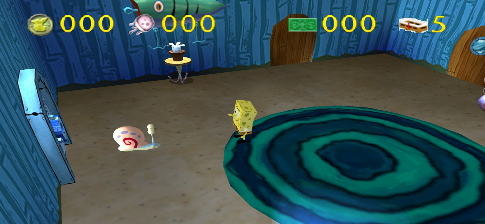
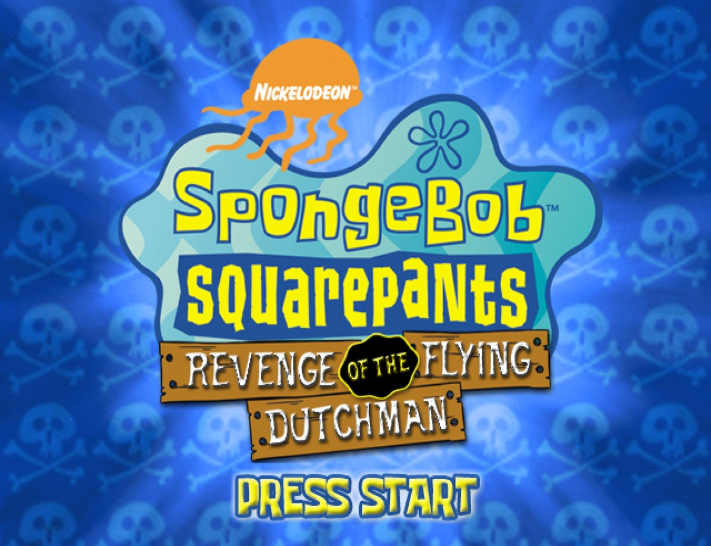

# SpongeBobRecomp

Standalone PC port of **SpongeBob SquarePants: Revenge of the Flying Dutchman**
(GameCube, NTSC-U, `GSQE78`), built by static recompilation.

**No game data is included.** You supply your own disc image.

[](https://recompstore.com/dev/spaced1127)



## Download

**[v0.1.2 - latest release](https://github.com/Spaced1127/SpongeBobRecomp/releases/latest)** (about 28 MB)

```text
SpongeBobRecomp-v0.1.2-Windows-x64.zip
SHA-256  D9C8CE801ACE8C298044C622C20999DB06346802DC3B4287C86E7B21D8A70764
```

## Requirements

- Windows 10/11 x64
- A Vulkan-capable GPU (OpenGL is also available)
- Your own NTSC-U ISO or RVZ of `GSQE78`

## Quick start

1. Extract the zip to a writable folder - not Program Files. The extracted
   game is written next to the executable.
2. Run `SpongeBobRecomp.exe`.
3. On **PLAY**, choose **Browse for ISO / WBFS / RVZ**, select your disc image,
   then **Extract and play**.
4. Press **PLAY**.

The extracted `Game/` folder is reused on later launches. Settings live in
`%LOCALAPPDATA%\SpongeBobRecomp\config.ini` and save automatically.

## RecompLauncher

**Works with [RecompLauncher](https://recomplauncher.com).** Install the release
from RecompLauncher, pick your USA ISO on its setup screen, and press Play.
RecompLauncher extracts the disc and starts the game directly; the same
settings, saves and logs are used. The custom launcher remains available for
RVZ files and manual imports.

## Screenshots

| Launcher | Title screen |
| --- | --- |
|  |  |

## Features

- Static recompilation: the shipped path runs native game code from
  `gGSQE78_recomp.dll`; no disc data is embedded.
- ISO and RVZ import with disc-ID and retail-DOL verification.
- Launcher pages: **PLAY**, **GRAPHICS**, **PERFORMANCE**, **AUDIO**,
  **CONTROLLER**.
- Vulkan/OpenGL, 1x-12x internal resolution, MSAA, SSAA, anisotropic
  filtering, VSync, aspect ratio and widescreen hack.
- 2D compatibility (EFB reads) on by default for the legal, title and menu
  screens.
- Native 60 FPS and an **Unlock frame rate** option.
- Fullscreen with no window border; **F11** or **Alt+Enter** toggles it.
- Audio mute and master volume.
- Controller profiles, netplay, savestates and memory-card saves.
- RecompLauncher setup, settings and verified-disc support.

## Status

Tested: ISO/RVZ import, legal and title screens, intro/logo movies at full
speed with clean audio, bedroom intro, pants pickup, bedroom -> living room
transition, HUD and NPCs, pause menu, Options, Save Game, Load Game, the
memory card, fullscreen, and launcher settings.

Still needs a person: a full story playthrough from the main menu to the end.
Automated input did not cover the main-menu flower-mat interaction, so that
path and the full game should be verified by playing it.

Known limitations:

- In-game pause-menu volume sliders were not verified. Use the launcher's
  **AUDIO** page for mute and volume.
- Very high MSAA + SSAA at 4x internal resolution can take a while to compile
  shaders. Wait for the **Compiling shaders** bar before closing.

## Controls

- **F11 / Alt+Enter** - toggle fullscreen
- **F1** - save state
- **Esc** - leave fullscreen; when windowed, closes the game
- **Space** - hold for fast-forward

Controller mapping is on the launcher's **CONTROLLER** page. See
[`docs/PLAYERS.md`](docs/PLAYERS.md).

## Graphics settings

Graphics options are applied when you press **PLAY**; they do not change a
running session. The runner logs the values it applied at startup:

```text
[video] backend=Vulkan scale=4 msaa=4 ssaa=0 af=4 vsync=1 aspect=1 widescreen=0 fullscreen=1
```

Logs are in `%LOCALAPPDATA%\SpongeBobRecomp\Logs\ModernGekko.log`. The
resolution dropdown is Dolphin's internal EFB scale, not the window size.

## Building

The included module was generated from a retail `main.dol` with DolRecomp and
the ModernGekko/Dolphin-derived runtime. Rebuilding requires the retail DOL,
MSVC/Clang, CMake and Ninja; helper scripts are in [`tools/`](tools/).

## License

The launcher, tools and documentation are distributed under the **GNU General
Public License v3.0** (see [`COPYING`](COPYING)). The runtime is built from
Dolphin (GPLv2+, aggregate GPLv3) and DolRecomp (GPLv3); see
[`THIRD_PARTY.md`](THIRD_PARTY.md) and
[`LICENSES-DolRecomp.txt`](LICENSES-DolRecomp.txt).

## Legal

SpongeBob SquarePants and Revenge of the Flying Dutchman are trademarks of
Nickelodeon and their respective owners. This project is not affiliated with or
endorsed by Nickelodeon, THQ or the original developers. No game data is
distributed; use your own legally owned disc image.
