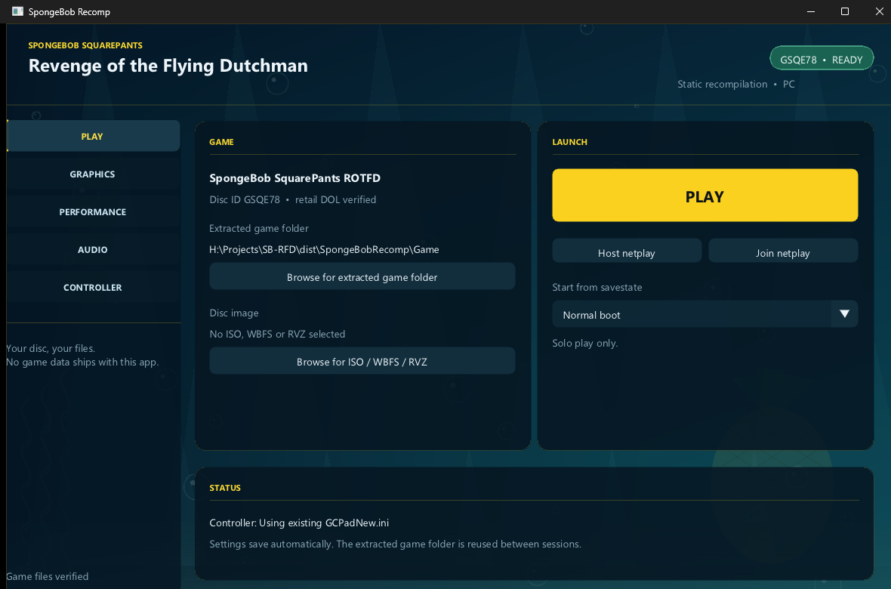

# SpongeBobRecomp

Standalone PC port of **SpongeBob SquarePants: Revenge of the Flying Dutchman**
(GameCube, USA, disc ID `GSQE78`) built by static recompilation of the retail
DOL. This repository hosts the launcher, helper tools and release packages.

**This repository and the release package contain no game assets.** There is no
ISO/RVZ, no extracted game folder, no textures, audio or level data. You must
supply your own original GameCube disc.

## Download

The current release is **v0.1.0**. Download `SpongeBobRecomp-Release.zip` from
the [Releases](../../releases) page (about 28 MB), extract it to a writable
folder and run `SpongeBobRecomp.exe`.

## Features

- Single launcher application (`SpongeBobRecomp.exe`) plus the game runner and
  the recompiled game module; no disc content is embedded.
- Built-in import of **ISO** and **RVZ** images with disc-ID and retail-DOL
  verification. The extracted game folder is reused between sessions and can be
  chosen anywhere.
- Native 60 FPS (PGO + AVX2 module) and an **Unlock frame rate** option.
- Graphical launcher with PLAY / GRAPHICS / PERFORMANCE / AUDIO / CONTROLLER
  pages and an animated underwater backdrop drawn procedurally at runtime.
- Internal resolution 1x-12x (640x528 to 7680x4320), MSAA, SSAA, anisotropic
  filtering, VSync, aspect ratio, widescreen hack, 2D compatibility (EFB reads).
- Audio mute and master volume.
- Fullscreen, controller profiles, netplay, savestates, memory-card saves.

## Requirements

- Windows 10/11 x64. (The runtime is Dolphin/ModernGekko-derived and portable in
  principle, but v0.1.0 ships Windows binaries.)
- A Vulkan-capable GPU (OpenGL is also selectable).
- Your own original **NTSC-U** copy of the game (disc ID `GSQE78`), as an ISO or
  RVZ image.

## Quick start

1. Extract `SpongeBobRecomp-Release.zip` anywhere you can write (not Program
   Files; the extracted game is written next to the executable).
2. Run `SpongeBobRecomp.exe`.
3. On **PLAY**, choose *Browse for ISO / WBFS / RVZ*, pick your disc image, then
   *Extract and play*. This creates a `Game/` folder beside the executable.
4. Press **PLAY**. Settings are stored in
   `%LOCALAPPDATA%\SpongeBobRecomp\config.ini` and save automatically.

See `docs/README.txt` for the full settings and troubleshooting reference and
`docs/PLAYERS.md` for controls.

## Status (v0.1.0)

Verified end to end: ISO and RVZ import (byte-identical retail `main.dol`),
launcher and settings, legal/title screens, intro and logo movies at full speed
with clean audio, bedroom intro, pants pickup, bedroom -> living room
transition, HUD and NPCs, pause menu, Options, Save Game, Load Game and the
memory card, at ~60 fps.

Known limitations:

- The playable main menu (Krusty Krab kitchen) renders and SpongeBob moves, but
  selecting an option with a flower mat has not worked in automated tests yet.
- The full story has not been play-tested end to end; the areas above are the
  tested sections.
- In-game (pause menu) volume sliders were not verified; the launcher's mute and
  master volume are the supported audio controls.

## Building

The recompiled module is produced from your own retail DOL with
[DolRecomp](https://github.com/ExpansionPak/DolRecomp) and the ModernGekko /
Dolphin-derived runtime. The launcher and runner are C++/CMake programs built
with MSVC and Clang. Helper scripts used during development are in `tools/`.

## License

The launcher, tools and documentation in this repository are distributed under
the **GNU General Public License v3.0** (see `COPYING`). The runtime is built
from Dolphin (GPLv2+, aggregate GPLv3) and DolRecomp (GPLv3); see
`THIRD_PARTY.md` and `LICENSES-DolRecomp.txt`.

## Legal

SpongeBob SquarePants and Revenge of the Flying Dutchman are trademarks of
Nickelodeon and their respective owners. This project is not affiliated with or
endorsed by Nickelodeon, THQ or the original developers. No game data is
distributed. The recompiled code is intended for use with a disc image you
legally own.
